<div align="center">
  
</div>

<p align="center">
  
  
  
</p>


<p align="center">
  
  
  
  
</p>

Offensive security tools built from scratch — for authorized pentesting, CTF competitions, and understanding what defenders are actually up against. Each project ships with a `BUILD_GUIDE.md` explaining the engineering decisions, not just the usage.

> Built on Kali Linux. For authorized testing environments only.

## Projects

| # | Project | Description | Status |
|---|---------|-------------|--------|
| 01 | [Port Scanner](projects/01-port-scanner/) | Async TCP port scanner with banner grabbing | Done |

## Philosophy

Most security tools are black boxes. This repo is the opposite — every tool comes with a documented build process so you understand what it does at the socket/syscall level. Reading a tool's source once teaches you more than running it a hundred times.

## Structure

Every project follows the same layout:

```
projects/NN-project-name/
├── README.md           # Usage and behavior
├── BUILD_GUIDE.md      # Step-by-step build walkthrough
├── CMakeLists.txt      # Build config (or Makefile/setup.py)
├── main.cpp            # Entry point
└── src/                # Source files
```

## Target Environment

- Kali Linux (rolling)
- All tools built and tested in isolated lab environments
- Never used against systems without explicit written authorization

## Author

**Daniel Gregg Jr**
- Portfolio: [daniel-eportfolio.web.app](https://daniel-eportfolio.web.app)
- TryHackMe: 140+ labs completed
